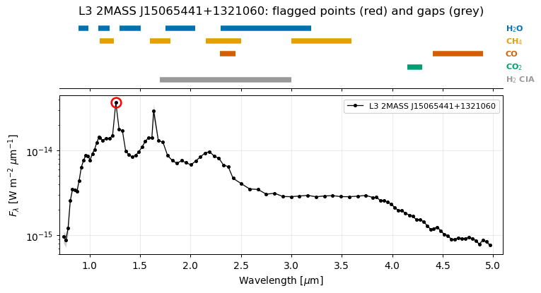
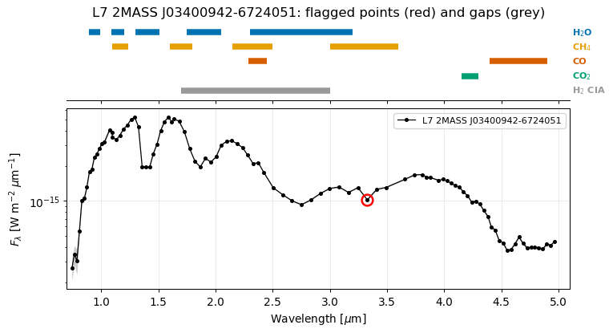
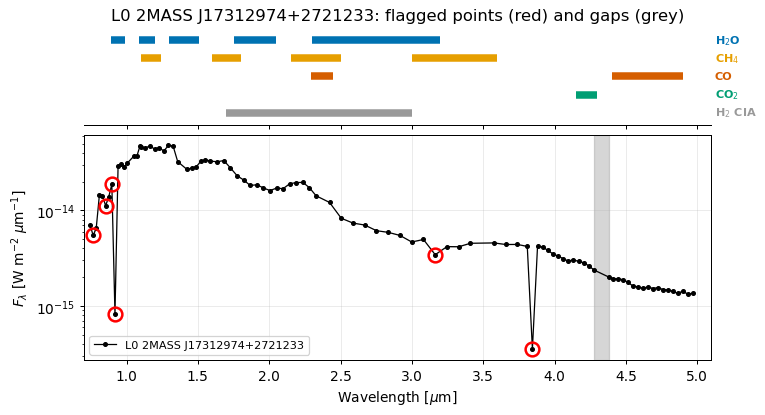

# Spotting data problems

[← Field guide](README.md) · Explained in [notebook 6 §9](../notebooks/06_fitting_models.ipynb)

**Check these before interpreting any feature.** Even the reference spectra, after strict flag cuts and a 4σ
running-median clip, contain some spurious points, and early data are underflagged (Rustamkulov et al. 2026).
Candidate spectra are cleaned unevenly. Run `print(bd.quality_report(spec))` — it flags, never deletes.

| Problem | What it looks like | Check |
|---|---|---|
| **Isolated outlier** | one point far above/below its neighbours; one big spike in the significance plot, often *outside* any band | does the feature survive if you ignore that point? |
| **Gap** | a stretch with no channels; an index or fit quietly uses fewer points | does every index region still have ≥ 3 channels? |
| **Uneven sampling** | irregular spacing between channels | channel widths are estimated from the spacing — near a gap they are less reliable |
| **Contamination by a neighbour** | a smooth, broad excess, not confined to one band (a bluer neighbour adds mostly short-wavelength flux) | look at the whole ratio plot, not one band |

## Real examples (installed reference spectra)

Red rings are points `bd.running_median_outliers` flags (>4σ from a 3-channel running median, with a 3%
systematic). A flag is a reason to look, not proof: steep real features (e.g. below 1 µm) can be flagged too.

Images are regenerated by `scripts/build_field_guide_figures.py`.
