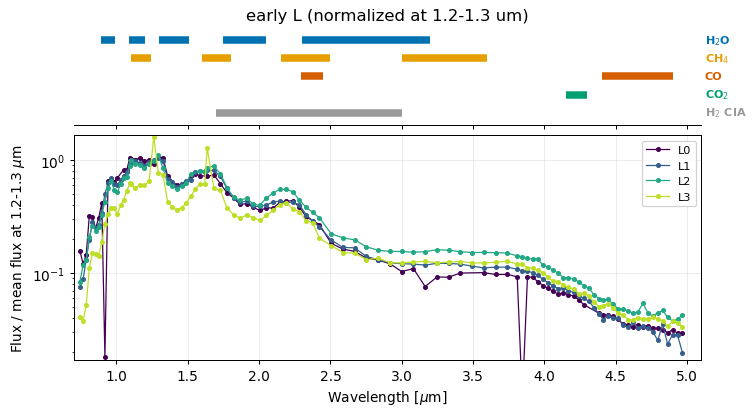
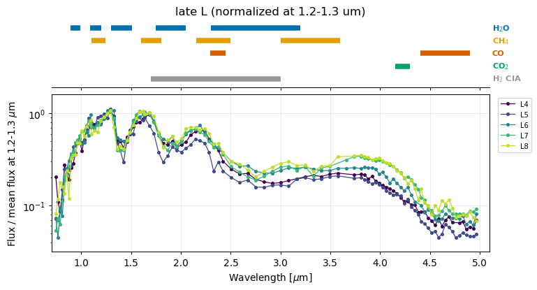
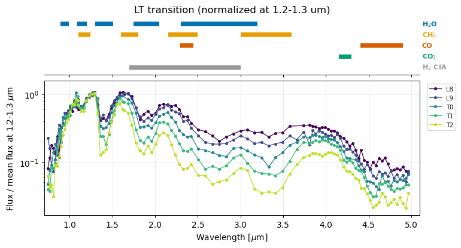
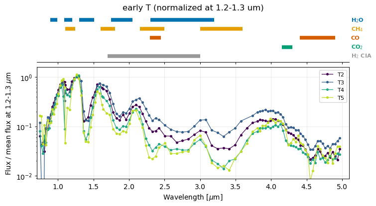
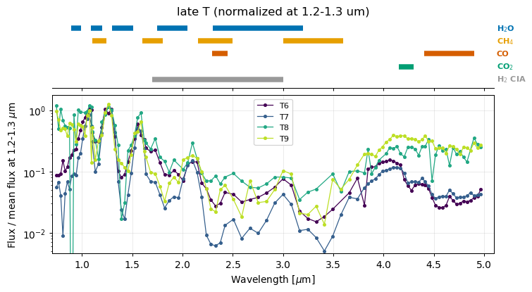
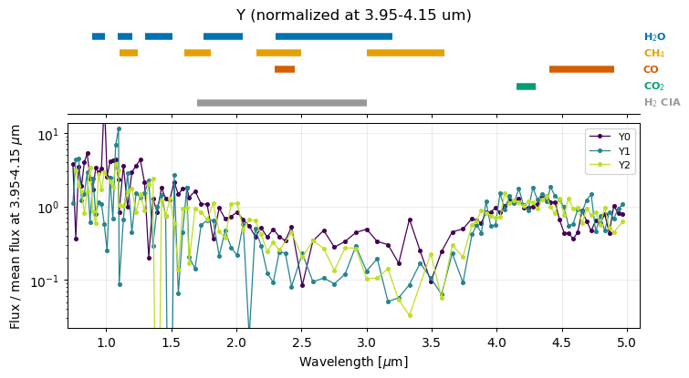

# Spectral sequence cheat sheet

[← Field guide](README.md) · Explained in [notebook 4](../notebooks/04_spectral_sequence.ipynb)

Temperatures: ~2500 K (L0) to ~250 K (~Y4) (Rustamkulov et al. 2026, Table 1). Our references stop at Y2: ~Y4
(WISE 0855−0714) is not in the public SPIFF release, and L9 and Y1 are stand-ins of the same type
(see `data/references/substitutes.csv`). Thumbnails are normalized at 1.2–1.3 µm (Y: 3.95–4.15 µm, because
Y dwarfs are barely detected at J), log flux axis.

| Group | Recognize it by | Thumbnail |
|---|---|---|
| **Early L** (L0–L3) | flux peaks in the near-IR, steep fall toward 5 µm; deep H2O troughs; no CH4; CO/CO2 notches only just starting |  |
| **Late L** (L4–L8) | CH4 appears after L4 as a downward curve at 3–3.6 µm; CO2 (4.15–4.3) and CO (4.4–4.9) notches grow; small 4.67 µm peak from L4 |  |
| **L/T transition** (L9–T2) | **K peak drops below H at T0**; 4 µm peak is at its sharpest; clouds clear and J brightens |  |
| **Early T** (T2–T5) | **H peak drops below J at T4**; narrow CH4 feature at 1.15 µm; CH4 dominates the short side of the 4 µm peak |  |
| **Late T** (T6–T9) | **CO and CO2 indices drop sharply between T6 and T7** (~1000→700 K); 4 µm peak shifts redward; T7 shows a weak 3.3 µm CH4 *emission* feature |  |
| **Y** (Y0–~Y4) | only flux beyond ~3.9 µm reliably detected; CH4 undetected at SPHEREx sensitivity (CH4 index not meaningful) |  |

**Adjacent subtypes** (e.g. L8 vs L9) differ by a few percent. Give a range and say how sure you are.
Thumbnails are regenerated by `scripts/build_field_guide_figures.py`.
